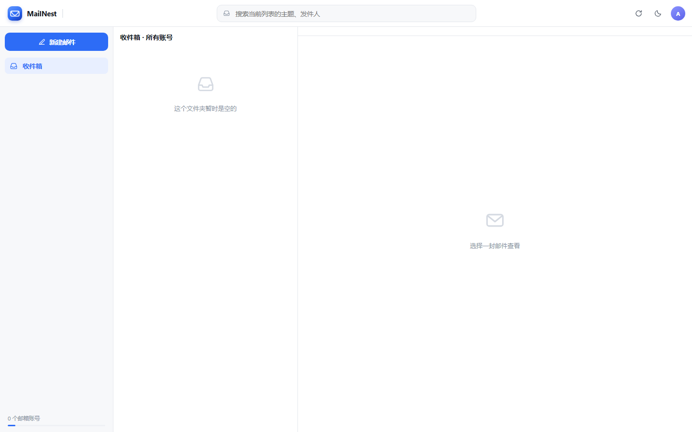

# MailNest

自托管的**多邮箱聚合收发** Web 客户端：把 QQ、163、Gmail、企业邮等账号收进同一个界面，支持多用户、凭据加密落盘。单容器、无数据库。



## 特性

- **多账号汇总**：「所有邮箱」把每个账号的收件箱合并成一列，未读总数一目了然，也可随时切到单个账号
- **多用户**：首次启动注册管理员；管理员可创建成员账户。每个用户的数据（凭据、草稿、缓存）存放在**独立目录**并用独立密钥 AES-256-GCM 加密——管理员也是运维角色，**看不到其他用户的邮件**
- **收发齐全**：IMAP 收信（文件夹 / 分页 / 已读 / 星标 / 移动 / 删除 / 附件下载）+ SMTP 发信（附件、回复引用、自动归档到「已发送」）
- **国内邮箱友好**：客户端握手自动发送 IMAP `ID` 命令（网易系必需）；GBK 等编码正确解码；服务器报错映射为中文提示
- **安全**：scrypt 密码哈希、HttpOnly + SameSite 会话 Cookie、登录失败限速、写操作 CSRF 头校验、HTML 正文净化
- **轻量**：Node 单进程，无数据库，`data/` 一个目录就是全部状态，备份即拷贝

## 快速开始

```bash
mkdir mailnest && cd mailnest
mkdir -p data
curl -O https://raw.githubusercontent.com/aaron2024S/mailnest/main/docker-compose.yml
docker compose up -d
```

浏览器打开 `http://NAS_IP:8006`：

1. 首次启动会要求**创建管理员账户**（注册入口只在这个时候开放，之后自动关闭）
2. 右上角头像 → **设置 → 邮箱账号 → 添加**，选择服务商预设或直接填 IMAP/SMTP 参数
3. 密码一栏填**授权码**（QQ/163 在网页端开启 IMAP/SMTP 后生成，不是网页登录密码）

常用服务器参数（应用内会按邮箱域名自动填充）：

| 邮箱 | IMAP | SMTP | 密码说明 |
|---|---|---|---|
| QQ | imap.qq.com:993 | smtp.qq.com:465 | 16 位授权码 |
| 163 / 126 | imap.163.com:993 | smtp.163.com:465 | 客户端授权密码 |
| Gmail | imap.gmail.com:993 | smtp.gmail.com:465 | 两步验证 + 应用专用密码 |
| 腾讯企业邮 | imap.exmail.qq.com:993 | smtp.exmail.qq.com:465 | 密码或授权码 |
| 阿里企业邮 | imap.qiye.aliyun.com:993 | smtp.qiye.aliyun.com:465 | 密码 |

> **Outlook / Microsoft 365**：微软已停用密码登录（IMAP/SMTP 仅接受 OAuth2）。支持 **设备码授权**：
> 添加账号时选 Outlook → 首次使用需注册一个免费的 Azure 应用（界面里有直达链接与 4 步指引），
> 把「应用程序(客户端) ID」填进设置保存 → 点「连接 Outlook」→ 在 `microsoft.com/devicelogin`
> 输入 8 位验证码完成授权。应用 ID 由界面填写、存在实例设置里（它不是密钥，公共客户端流程不使用 secret），
> 所有用户共用，随时可在「更换应用 ID」里修改。

## 安全建议

- 请通过**反向代理 + HTTPS** 暴露到公网，并在 compose 里把 `MAILNEST_SECURE_COOKIES` 改为 `true`；只在内网用可以保持 `false`
- `data/` 里是所有用户的加密凭据与登录会话，`secret.key` 是加密主密钥——**备份要带上整个目录，但不要把它放到不可信的地方**
- 管理员重置成员密码会生成一次性临时密码，请线下转交，对方登录后应尽快修改

## 从源码运行

```bash
npm ci
npm start          # 默认 8006 端口，数据在 ./data
```

环境变量：`PORT`（默认 8006）、`HOST`、`MAILNEST_DATA`（数据目录，默认 `./data`）、`MAILNEST_SECURE_COOKIES`。

> 换端口：compose 目录下放 `.env` 写 `PORT=9000`，或 `PORT=9000 docker compose up -d`。

## 构建镜像 / 发版

镜像只通过 GitHub Actions 构建发布（amd64 + arm64）：在 Actions 页面手动运行 **docker-publish** workflow，填入版本号即可，会推送 `<version>` 和 `latest` 两个 tag。

```bash
# 本地构建（需要 Docker 引擎）
docker build -t mailnest:dev .
```

## License

MIT。`public/vendor/vue.global.prod.js` 为 Vue.js 3（MIT），见 NOTICE。
